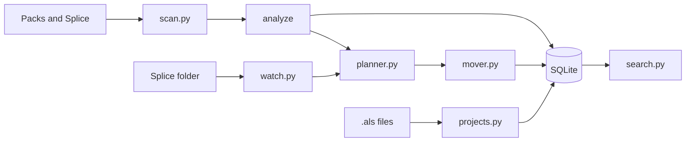

# Architecture

Crate is a local librarian for an Ableton Live sample library. It hears a file, files it into a shallow folder tree Live can browse, and keeps an index so you can find the sound again. Moving files is journaled and reversible. Audio bytes are never rewritten.

## Modules

- `cli.py` — Typer commands. Anything that changes files is a dry run until `--apply`.
- `scan.py` — Walks folders, extracts zip files into a staging directory, and records the pack name and parent folders. Folder names are a classification signal.
- `analyze/metadata.py` — Type, loop, BPM, key, and character words from the filename and folders.
- `analyze/audio.py` — Decodes WAV (and other formats via soundfile). `content_hash` is the decoded PCM. `fingerprint` is a coarse loudness shape used only to report near-duplicates.
- `analyze/features.py` — Duration, onsets, crest, attack, decay, spectrum, tempo, key, and swing. The first 30 seconds are enough for the features. The hash still covers the whole file.
- `analyze/clap.py` — Optional CLAP zero-shot scores (`uv sync --extra ml`). Prompts live in the config. Apple Silicon uses MPS when PyTorch provides it.
- `analyze/fusion.py` — Metadata and audio agree: high confidence. They disagree: audio wins unless the filename is explicit. A manual correction always wins. Below `review_threshold` (default 0.6) the file goes to `_Review/`.
- `analyze/engine.py` — Parallel analysis. Features are cached in `analysis` by content hash, so a later rule change does not re-read the audio.
- `taxonomy.py` — Maps a label onto the configured folder, at most `max_depth` levels.
- `planner.py` — Builds the from-to list. Copies out of the Splice folder when `keep_originals` is set. Splits a folder on punch, snare body, or feel only once it would pass `split_folder_threshold` (default 300). Exact duplicates follow `duplicates` (`trash`, `quarantine`, `keep`, `symlink`). Near-duplicates are notes, never deletions.
- `mover.py` — Writes each operation to SQLite before it runs. Same-volume moves are renames. Cross-volume moves copy, check size and hash, then delete the source. `undo` walks the batch backward.
- `search.py` — `find`, `where`, and similarity over the cached features.
- `projects.py` — Reads sample names and paths out of gzipped `.als` files and compares them to the library.
- `watch.py` / `menubar.py` — Polls the Splice folder. Files already there are left alone unless `--backfill`. `--menu` adds a macOS status item when PyObjC is installed (`uv sync --extra mac`). The status line is `12 filed, 3 need review`.

## What is stored

`files` is the current location of each library file, plus the label used to file it. `analysis` is the raw measurements, keyed by PCM hash. `corrections` is the manual label for that hash. `ops` is the journal. `project_samples` is what Live sets reference. `seen` is what `watch` has already noticed.
